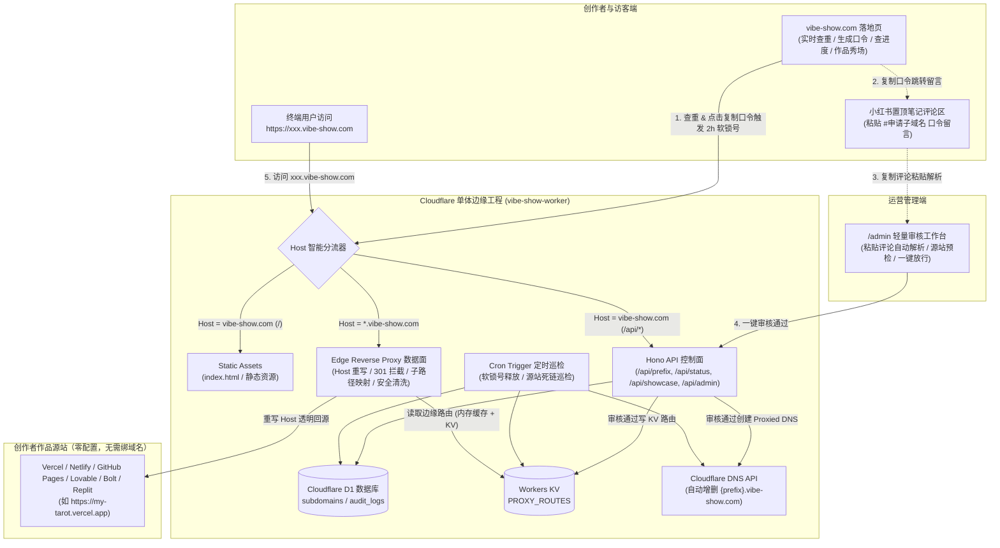
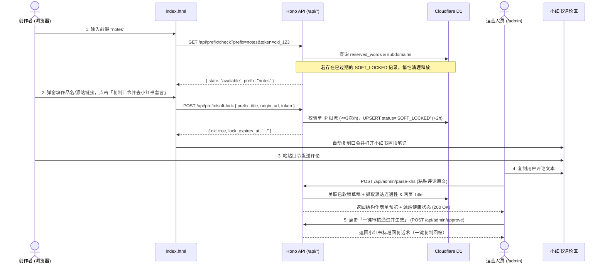

# vibe-show.com 后端技术方案文档（Technical Design v2.0）

> **核心设计原则**：
> 1. **全托管 Cloudflare 零成本架构**：单工程统一承载静态落地页（Static Assets）、REST API（Hono）、数据库（Cloudflare D1）、毫秒级路由表（Workers KV）与定时巡检（Cron Triggers）。
> 2. **网页 2h 软锁号 + 小红书评论区闭环**：网页点击「复制口令」即触发 2 小时软锁号并暂存草稿；运营在轻量后台粘贴小红书评论一键解析、预检源站并审核放行。
> 3. **全平台统一 Worker 边缘反向代理（创作者 0 配置）**：不论作品部署在 Vercel、Netlify、GitHub Pages 还是 Lovable、Bolt、Replit，创作者**均无需在平台后台绑定自定义域名**；审核通过即自动写入 Cloudflare DNS 与 KV 路由，1 秒内全球 HTTPS 生效。

---

## 一、 整体系统架构与技术栈

### 1.1 技术选型一览

| 模块 | 技术选型 | 职责说明 | 免费额度与成本 |
| :--- | :--- | :--- | :--- |
| **权威 DNS 与 SSL** | **Cloudflare DNS + Universal SSL** | 通过 REST API 自动创建 `{prefix}.vibe-show.com` 代理记录；免费覆盖 `*.vibe-show.com` 泛域名 HTTPS 证书。 | **¥0/月**（Free Plan） |
| **统一边缘运行时** | **Cloudflare Workers (with Static Assets)** | 基于 `Host` 请求头智能分流：主域名走静态页面与 `/api/*` 控制面接口；子域名走边缘反向代理数据面。 | **¥0/月**（静态资源无限免费，Worker 10 万次/天） |
| **API 框架** | **Hono (TypeScript)** | 超轻量边缘 Web 框架（<14KB），承载查重、软锁号、进度查询、秀场接口与 `/admin` 审核后台。 | **¥0/月** |
| **持久化数据库** | **Cloudflare D1 (SQLite)** | 存储子域名注册表、2h 软锁号记录、作品秀场元数据、系统保留字与审核日志。 | **¥0/月**（5GB 存储，500 万行读/天） |
| **边缘反代路由表** | **Cloudflare Workers KV (`PROXY_ROUTES`)** | 存储 `prefix -> { origin_url, status, ... }` 映射，全球边缘节点 <5ms 读取（配合 Worker 内存 60s 缓存）。 | **¥0/月**（10 万次读/天） |
| **定时任务** | **Cloudflare Cron Triggers** | 每 30 分钟清理过期软锁号；每日凌晨巡检已上线作品源站连通性，自动处理死链。 | **¥0/月** |

---

### 1.2 全链路架构图



---

## 二、 数据库设计（Cloudflare D1）

文件路径规划：`migrations/0001_init.sql`

```sql
-- 1. 子域名核心生命周期表
CREATE TABLE IF NOT EXISTS subdomains (
    id                  INTEGER PRIMARY KEY AUTOINCREMENT,
    prefix              TEXT NOT NULL UNIQUE,               -- 唯一子域名前缀，如 'tarot'
    status              TEXT NOT NULL DEFAULT 'SOFT_LOCKED',-- 状态枚举: SOFT_LOCKED / PENDING_REVIEW / ACTIVE / REJECTED / REVOKED
    
    -- 源站与反向代理配置
    platform            TEXT NOT NULL DEFAULT 'vercel',     -- 识别平台: vercel / netlify / github / cloudflare / lovable / bolt / other
    origin_url          TEXT NOT NULL DEFAULT '',           -- 创作者原始作品地址，如 https://my-tarot.vercel.app
    cf_record_id        TEXT,                               -- Cloudflare DNS API 返回的 Record ID（用于回收时精准删除）

    -- 秀场展示元数据（对齐前端 SHOWCASE_ITEMS 结构）
    title               TEXT NOT NULL DEFAULT '',           -- 作品名称（<=30字）
    category            TEXT NOT NULL DEFAULT 'tool',       -- 分类: tool(效率工具) / creative(创意玩具) / game(独立小游戏)
    stack               TEXT NOT NULL DEFAULT 'AI + Web',   -- 技术栈标签，如 'Claude + Cursor' / 'Lovable + Canvas'
    tagline             TEXT NOT NULL DEFAULT '',           -- 一句话简介（<=40字）
    author_name         TEXT NOT NULL DEFAULT '',           -- 创作者署名 / 小红书昵称（如 '@星河Coder'）
    xhs_comment_raw     TEXT,                               -- 原始小红书评论备份
    theme_bg            TEXT NOT NULL DEFAULT 'from-[#EDF5FF] via-[#E3EFFE] to-[#D5E6FB]', -- 卡片渐变主题
    is_dark             INTEGER NOT NULL DEFAULT 0,         -- 深色卡片模式: 0 / 1
    is_featured         INTEGER NOT NULL DEFAULT 0,         -- 是否「★ 本周精选」: 0 / 1
    show_in_gallery     INTEGER NOT NULL DEFAULT 1,         -- 是否在首页秀场展示: 0 / 1

    -- 软锁号与防刷追踪
    client_token        TEXT,                               -- 网页端匿名会话标识（允许本人重复修改口令）
    client_ip_hash      TEXT,                               -- 客户端 IP 哈希（用于限制单 IP 每小时最多软锁 3 个前缀）
    lock_expires_at     DATETIME,                           -- 软锁号过期时间（当前时间 + 2 小时）

    -- 审核与健康巡检追踪
    status_note         TEXT,                               -- 面向用户进度查询展示的提示语
    fail_streak         INTEGER NOT NULL DEFAULT 0,         -- 连续健康巡检失败天数（满 30 天自动回收）
    last_http_status    INTEGER,                            -- 最近一次源站探测 HTTP 状态码
    approved_at         DATETIME,                           -- 审核通过并上线时间
    last_checked_at     DATETIME,                           -- 最近一次 Cron 巡检时间
    created_at          DATETIME NOT NULL DEFAULT CURRENT_TIMESTAMP,
    updated_at          DATETIME NOT NULL DEFAULT CURRENT_TIMESTAMP
);

CREATE INDEX IF NOT EXISTS idx_subdomains_status_gallery ON subdomains(status, show_in_gallery, is_featured, approved_at DESC);
CREATE INDEX IF NOT EXISTS idx_subdomains_lock_expires ON subdomains(status, lock_expires_at);
CREATE INDEX IF NOT EXISTS idx_subdomains_author ON subdomains(author_name);
CREATE INDEX IF NOT EXISTS idx_subdomains_ip_hash ON subdomains(client_ip_hash, created_at);

-- 2. 系统保留字表
CREATE TABLE IF NOT EXISTS reserved_words (
    word                TEXT PRIMARY KEY,
    reason              TEXT NOT NULL DEFAULT 'SYSTEM',
    created_at          DATETIME NOT NULL DEFAULT CURRENT_TIMESTAMP
);

-- 初始化核心保留字
INSERT OR IGNORE INTO reserved_words (word) VALUES
('www'),('api'),('admin'),('app'),('mail'),('smtp'),('imap'),('pop'),('mx'),('ns1'),('ns2'),
('cdn'),('static'),('assets'),('img'),('docs'),('blog'),('status'),('help'),('support'),
('dev'),('test'),('staging'),('auth'),('login'),('account'),('pay'),('billing'),('official'),
('vibe'),('show'),('root'),('dashboard'),('console'),('security'),('abuse'),('edge'),('proxy');
```

---

## 三、 四大核心模块详细技术方案

### 模块 1：申请模块（实时查重 + 2h 软锁号 + 小红书评论一键解析）

#### 1.1 申请业务时序图



#### 1.2 软锁号（Soft-Lock）核心设计细节
1. **惰性释放 + 定时清理双保险**：
   - 在 `/api/prefix/check` 与 `/api/prefix/soft-lock` 查询时，SQL 条件自带过期判断：
     `status = 'SOFT_LOCKED' AND lock_expires_at > datetime('now')`。
   - 若某前缀曾被软锁但已超过 2 小时未转正，新用户查重时直接视为 `available`，并在软锁时直接覆盖原过期记录。
2. **本人重入豁免**：
   - 前端首次访问时在 `localStorage` 生成随机 `vibe_client_token`。
   - 同一用户反复打开弹窗修改作品名或源站 URL 并点击复制口令时，由于 `client_token` 一致，系统刷新其 `title`、`origin_url` 与 `lock_expires_at`，不会误报「已被他人锁定」。
3. **防恶意占坑限流**：
   - 对请求头 `CF-Connecting-IP` 进行 SHA-256 哈希（加盐）记入 `client_ip_hash`。
   - 统计过去 1 小时内该 IP 锁定的不同前缀数，若 `>= 3` 则拒绝新增锁号（仍允许复制口令去小红书人工留言，但不再锁号）。

#### 1.3 后台小红书评论智能解析器（Parser）
运营在 `/admin` 粘贴任意格式的小红书评论，后端正则自动提取：
```typescript
export function parseXhsComment(raw: string) {
  // 1. 提取前缀：匹配 #申请子域名 xxx 或 xxx.vibe-show.com
  const prefixMatch = raw.match(/#申请子域名\s+([a-z0-9-]{3,30})/i)
                   || raw.match(/([a-z0-9-]{3,30})\.vibe-show\.com/i);
  // 2. 提取作品名：匹配 "作品：xxx"
  const titleMatch = raw.match(/作品[:：]\s*([^\n\r]+)/);
  // 3. 提取链接：匹配 https?://...
  const urlMatch = raw.match(/https?:\/\/[^\s"'<>]+/i);
  // 4. 提取作者昵称：若首行非口令标签，则自动识别为 @昵称
  const firstLine = raw.trim().split(/\r?\n/)[0]?.trim() || '';
  const author = (!firstLine.startsWith('#') && !firstLine.includes('：') && firstLine.length <= 24)
    ? (firstLine.startsWith('@') ? firstLine : `@${firstLine}`)
    : '';

  return {
    prefix: prefixMatch ? prefixMatch[1].toLowerCase() : '',
    title: titleMatch ? titleMatch[1].trim() : '',
    origin_url: urlMatch ? urlMatch[0].trim() : '',
    author_name: author
  };
}
```
> **草稿自动补全**：如果用户在小红书评论里只发了 `#申请子域名 notes` 而忘了贴链接（或链接被小红书吞掉），解析器会自动从 D1 的 `SOFT_LOCKED` 记录中找回该用户在网页弹窗里预填的 `origin_url` 和 `title`！

---

### 模块 2：查询模块（查重、四阶段进度、作品秀场）

#### 2.1 接口契约（与现有 `index.html` 无缝对接）

##### (1) 前缀实时查重：`GET /api/prefix/check?prefix=notes&token=xxx`
```json
{
  "prefix": "notes",
  "state": "available", // available | taken | locked | reserved | invalid
  "owner": null,        // state === 'taken' 时返回 "@星河Coder"
  "lock_remaining_minutes": null, // state === 'locked' 时返回剩余锁号分钟数
  "suggestions": []     // state === 'taken' | 'locked' 时返回 ["notes-ai", "mynotes", "notes-app"]
}
```

##### (2) 审核与解析进度查询：`GET /api/applications/status?prefix=tarot`
直接对齐前端 `STAGES = ['已提交', '人工审核', '解析生效', '已上线']`：
```json
{
  "found": true,
  "prefix": "tarot",
  "status": "ACTIVE",
  "done": 4,
  "platform": "Vercel",
  "author": "@星河Coder",
  "title": "CyberTarot 赛博塔罗",
  "note": "已上线，全球 HTTPS 边缘加速已生效，作品已登上首页灵感秀场。"
}
```
- **状态到 `done` 阶段映射表**：
  - `SOFT_LOCKED`（未过期） $\rightarrow$ `done: 1`，`note`: `"已为你临时锁定该前缀（有效期剩余 X 分钟），请尽快前往小红书置顶笔记评论区粘贴口令留言。"`
  - `PENDING_REVIEW` $\rightarrow$ `done: 2`，`note`: `"已收到你的小红书留言，正在人工审核源站内容，预计 24 小时内完成。"`
  - `ACTIVE` $\rightarrow$ `done: 4`，`note`: `"已上线！无需在部署平台做任何配置，直接访问 https://xxx.vibe-show.com 即可，作品已登上首页秀场。"`

##### (3) 首页作品秀场与跑马灯查询：`GET /api/showcase`
- 返回所有 `status = 'ACTIVE' AND show_in_gallery = 1` 的作品列表（按 `is_featured DESC, approved_at DESC` 排序）、总数统计 `total_claimed`、以及最近认领的 16 个前缀供跑马灯展示。
- **边缘缓存策略**：使用 Cloudflare Cache API 缓存 `60s`，当后台执行 `approve` / `revoke` 时主动清除缓存，保证首页千人千面零延迟且不消耗数据库配额。

---

### 模块 3：DNS 生效与全平台零配置边缘反代（核心引擎）

#### 3.1 为什么采用「API 显式创建 DNS 记录 + Worker 泛域名边缘反代」？

1. **创作者体验降维打击（0 配置）**：
   - 传统 CNAME 方案要求创作者去 Vercel / Netlify / GitHub Pages 后台添加自定义域名，还会遇到跨账号 TXT 归属验证报错、SSL 签发卡死等问题。
   - 采用 **Worker 全量边缘反向代理** 后，创作者在任何平台部署完拿到原始链接（如 `https://my-app.vercel.app` 或 `https://my-app.lovable.app`）即可，**平台侧 0 操作**。
2. **权威 DNS 层按需开通（防扫描 + 强可观测）**：
   - 审核通过时，后端调用 Cloudflare DNS API 创建显式记录：
     ```http
     POST https://api.cloudflare.com/client/v4/zones/{CF_ZONE_ID}/dns_records
     Authorization: Bearer {CF_API_TOKEN}
     Content-Type: application/json

     {
       "type": "A",
       "name": "notes.vibe-show.com",
       "content": "192.0.2.1",
       "proxied": true,
       "ttl": 1,
       "comment": "vibe-show: @星河Coder -> https://my-notes.vercel.app"
     }
     ```
   - `192.0.2.1` 是 Cloudflare 官方标准无源站占位 IP（RFC 5737），开启 `proxied: true`（小黄云）后，所有访问 `https://notes.vibe-show.com` 的流量直接进入绑定了 `*.vibe-show.com/*` 路由的 Cloudflare Worker，并自动使用 Cloudflare 免费签发的 `*.vibe-show.com` Universal SSL 证书。
   - 未分配的子域名在 DNS 层直接返回 `NXDOMAIN`，不会触发 Worker 计费请求，且彻底杜绝 Subdomain Takeover（子域名劫持）。

#### 3.2 边缘反向代理引擎（Edge Reverse Proxy）核心实现

针对 Vercel / Next.js / Vite / GitHub Pages（含子路径）/ Lovable 等不同源站，反代引擎重点解决以下 **5 大工程细节**：

1. **Host Header 与 SNI 自动对齐**：
   - 回源请求必须使用源站自身的 Hostname（如 `my-notes.vercel.app`），否则 Vercel / Netlify 会因为未绑定 `notes.vibe-show.com` 返回 404。
2. **拦截 301/302/307/308 重定向防跳回原域名**：
   - 使用 `redirect: 'manual'`，当源站返回 `Location: https://my-notes.vercel.app/dashboard` 时，自动重写为 `Location: https://notes.vibe-show.com/dashboard`，锁死浏览器地址栏。
3. **支持带子路径的源站（如 GitHub Pages `https://user.github.io/repo-name`）**：
   - 若 `origin_url` 包含路径前缀 `/repo-name`，访问 `https://notes.vibe-show.com/assets/app.js` 时智能拼接到 `/repo-name/assets/app.js`；若前端构建产物引用了 `/repo-name/...` 绝对路径，反代亦兼容直通避免重复拼接。
4. **两级路由缓存（Worker 内存 Map + Workers KV）**：
   - Worker 全局变量维护一个 60 秒 TTL 的内存 `Map` 缓存，高频访问同一作品时连 KV 读取配额都不消耗；未命中时从 `env.PROXY_ROUTES.get(prefix, 'json')` 读取。
5. **安全响应头清洗**：
   - 删除源站下发的跨父域 `Set-Cookie`（防止污染 `.vibe-show.com`），移除阻止嵌入或跨域的冲突头，透传 WebSocket 与流式响应（SSE）。

```typescript
// src/proxy.ts 核心反代逻辑
interface ProxyRoute {
  origin: string;   // 例如 "https://my-notes.vercel.app" 或 "https://user.github.io/repo"
  status: string;   // "ACTIVE"
  title?: string;
}

const memoryRouteCache = new Map<string, { data: ProxyRoute | null; exp: number }>();

export async function handleSubdomainProxy(request: Request, env: Env, prefix: string): Promise<Response> {
  const now = Date.now();
  let route: ProxyRoute | null = null;

  // 1. 优先读 Worker 内存 60s 缓存，次选读 Workers KV
  const cached = memoryRouteCache.get(prefix);
  if (cached && cached.exp > now) {
    route = cached.data;
  } else {
    route = await env.PROXY_ROUTES.get<ProxyRoute>(prefix, 'json');
    memoryRouteCache.set(prefix, { data: route, exp: now + 60_000 });
  }

  // 未生效或已回收的子域名，优雅重定向回主站认领页
  if (!route || route.status !== 'ACTIVE' || !route.origin) {
    return Response.redirect(`https://vibe-show.com/?claim=${encodeURIComponent(prefix)}`, 302);
  }

  const incomingUrl = new URL(request.url);
  const originBase = new URL(route.origin);

  // 2. 智能处理源站子路径拼接（兼容 GitHub Pages /repo 等场景）
  const basePath = originBase.pathname.replace(/\/$/, '');
  let targetPathname = incomingUrl.pathname;
  if (basePath && !targetPathname.startsWith(basePath + '/') && targetPathname !== basePath) {
    targetPathname = basePath + (targetPathname.startsWith('/') ? targetPathname : '/' + targetPathname);
  }
  const targetUrl = new URL(targetPathname + incomingUrl.search, originBase.origin);

  // 3. 构造干净的回源请求头（重写 Host 为源站域名）
  const reqHeaders = new Headers(request.headers);
  reqHeaders.set('Host', originBase.host);
  reqHeaders.set('X-Forwarded-Host', incomingUrl.host);
  reqHeaders.set('X-Forwarded-Proto', 'https');
  reqHeaders.delete('cf-connecting-ip');
  reqHeaders.delete('cf-ipcountry');
  reqHeaders.delete('cf-ray');
  reqHeaders.delete('cf-visitor');

  const upstreamRes = await fetch(targetUrl.toString(), {
    method: request.method,
    headers: reqHeaders,
    body: ['GET', 'HEAD'].includes(request.method) ? null : request.body,
    redirect: 'manual'
  });

  const resHeaders = new Headers(upstreamRes.headers);

  // 4. 拦截 301/302/307/308 重定向，防止跳回源站丑域名
  const location = resHeaders.get('Location');
  if (location && [301, 302, 303, 307, 308].includes(upstreamRes.status)) {
    try {
      const locUrl = new URL(location, targetUrl);
      if (locUrl.host === originBase.host) {
        locUrl.host = incomingUrl.host;
        locUrl.protocol = 'https:';
        if (basePath && locUrl.pathname.startsWith(basePath)) {
          locUrl.pathname = locUrl.pathname.slice(basePath.length) || '/';
        }
        resHeaders.set('Location', locUrl.toString());
      }
    } catch {}
  }

  // 5. 安全加固：禁止源站设置宽泛父域 Cookie
  resHeaders.delete('Set-Cookie');
  resHeaders.set('X-Vibe-Show-Proxy', '1');

  return new Response(upstreamRes.body, {
    status: upstreamRes.status,
    statusText: upstreamRes.statusText,
    headers: resHeaders
  });
}
```

---

### 模块 4：部署架构与工程规划（Cloudflare 一键部署）

#### 4.1 推荐工程目录结构

```text
d:\vibe-projects\vibe-show\
├── public/                     # 静态资源目录（Cloudflare Workers Static Assets 免费托管）
│   ├── index.html              # 主站落地页（与当前 index.html 同步）
│   └── admin.html              # 轻量运营审核工作台（粘贴小红书评论 / 一键审核 / 域名管理）
├── src/                        # Worker 服务端源码 (TypeScript + Hono)
│   ├── index.ts                # 统一入口：根据 Host 分流主站 API 与 *.vibe-show.com 反代 + Cron 入口
│   ├── types.ts                # Env 绑定类型定义 (DB, PROXY_ROUTES, CF_ZONE_ID, CF_API_TOKEN, ADMIN_TOKEN)
│   ├── proxy.ts                # *.vibe-show.com 边缘反向代理引擎
│   ├── routes/
│   │   ├── public.ts           # 公开 API：/api/prefix/check, /api/prefix/soft-lock, /api/applications/status, /api/showcase
│   │   └── admin.ts            # 管理 API：/api/admin/parse-xhs, /api/admin/approve, /api/admin/reject, /api/admin/revoke
│   ├── services/
│   │   ├── cf-dns.ts           # Cloudflare DNS API 封装（创建/删除 {prefix}.vibe-show.com 记录）
│   │   ├── xhs-parser.ts       # 小红书评论文本解析与源站预检器（HTTP 状态探测 + 网页标题提取 + 大陆 IP 拦截）
│   │   └── cron.ts             # 定时任务：过期软锁号清理 + 已上线站点死链巡检
├── migrations/
│   └── 0001_init.sql           # D1 数据库表结构与初始数据（含内置精选作品与保留字）
├── wrangler.toml               # Cloudflare 一体化部署配置
├── package.json
└── tsconfig.json
```

#### 4.2 `wrangler.toml` 核心配置设计

```toml
name = "vibe-show"
main = "src/index.ts"
compatibility_date = "2025-02-01"

# 1. 静态资源托管（主站 index.html 与 /admin.html 走免费静态资产层，API 走 Worker）
[assets]
directory = "./public"
binding = "ASSETS"
run_worker_first = ["/api/*"]

# 2. 路由绑定：主域名 + 泛子域名全部由同一个 Worker 处理
routes = [
  { pattern = "vibe-show.com/*", zone_name = "vibe-show.com" },
  { pattern = "www.vibe-show.com/*", zone_name = "vibe-show.com" },
  { pattern = "*.vibe-show.com/*", zone_name = "vibe-show.com" }
]

# 3. D1 数据库绑定
[[d1_databases]]
binding = "DB"
database_name = "vibe-show-db"
database_id = "<创建后填入>"

# 4. Workers KV 绑定（毫秒级反代路由表）
[[kv_namespaces]]
binding = "PROXY_ROUTES"
id = "<创建后填入>"

# 5. 定时任务：每 30 分钟清理过期软锁号，每天 04:00 巡检源站可用性
[triggers]
crons = ["*/30 * * * *", "0 20 * * *"]

[vars]
DOMAIN = "vibe-show.com"
```

#### 4.3 五步上线部署流程（SOP）

1. **创建 Cloudflare D1 与 KV**：
   ```bash
   npx wrangler d1 create vibe-show-db
   npx wrangler kv namespace create PROXY_ROUTES
   ```
2. **执行数据库初始化迁移**：
   ```bash
   npx wrangler d1 migrations apply vibe-show-db --remote
   ```
3. **配置安全密钥（Secrets）**：
   - `CF_ZONE_ID`：Cloudflare 面板 `vibe-show.com` 概览页右侧的 Zone ID。
   - `CF_API_TOKEN`：在 Cloudflare 创建仅拥有 `vibe-show.com` 单域名的 `Zone -> DNS -> Edit` 权限的 API Token。
   - `ADMIN_TOKEN`：访问 `/admin` 审核后台的管理口令。
   ```bash
   npx wrangler secret put CF_ZONE_ID
   npx wrangler secret put CF_API_TOKEN
   npx wrangler secret put ADMIN_TOKEN
   ```
4. **本地联调测试**：
   ```bash
   npx wrangler d1 migrations apply vibe-show-db --local
   npm run dev
   ```
5. **一键发布生产环境**：
   ```bash
   npm run deploy
   ```

---

## 四、 前后端衔接改造清单（下一步可直接落地）

为了让现有 [`index.html`](file:///d:/vibe-projects/vibe-show/index.html) 与本后端方案 100% 闭环，仅需做以下轻量衔接：

1. **升级第 03 屏「接入指南」文案**：
   - 当前 [`index.html`](file:///d:/vibe-projects/vibe-show/index.html#L1580-L1611) 中 Vercel / Netlify / GitHub Pages 选项卡仍提示用户“去控制台添加自定义域名”。
   - 改为统一突出 **「全平台零配置接入：无论部署在 Vercel / GitHub Pages 还是 Lovable / Bolt，均无需在平台后台绑域名，小红书留言附上原链接即可由 Cloudflare 边缘反代秒级生效 HTTPS」**。
2. **前端接口真实化（带 Mock 降级兜底）**：
   - 查重框调用 `GET /api/prefix/check`，复制口令按钮调用 `POST /api/prefix/soft-lock`，查进度调用 `GET /api/applications/status`，秀场初始化调用 `GET /api/showcase`（本地直接双击打开 `index.html` 时自动降级使用内置演示数据，部署后自动走真实 API）。
3. **搭建 `/admin` 运营审核单页**：
   - 提供小红书评论粘贴框 $\rightarrow$ 自动提取字段 + 源站连通性测试 $\rightarrow$ 点击「审核通过」自动写 D1 + KV + Cloudflare DNS $\rightarrow$ 一键复制小红书回复话术。
